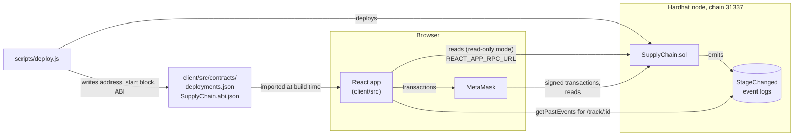
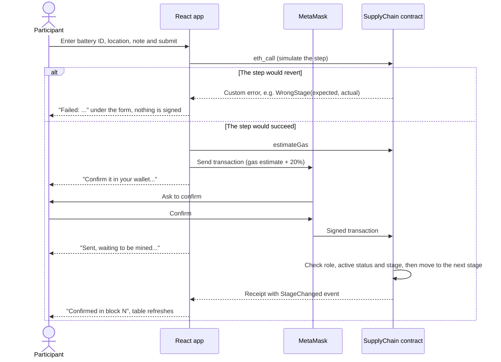

# Battery Supply Chain on Ethereum

[](https://github.com/ArunSanyal/Supply-Chain-Blockchain/actions/workflows/ci.yml)

This project tracks a battery as it moves through a supply chain, from the order to the final sale. Each handoff is a transaction on an Ethereum chain that emits a `StageChanged` event, and those events can't be changed afterwards, so they are a permanent record of who moved the battery at each stage and when. It is a Solidity smart contract with a React frontend that reads from it directly or sends transactions through MetaMask.

## Features

- A battery goes through six stages in a fixed order: Ordered, Raw Material Supply, Manufacturing, Distribution, Retail, Sold. The contract rejects a step from the wrong role, a skipped stage or a repeated one.
- The owner registers participants for four roles (raw material supplier, manufacturer, distributor, retailer), and can edit, deactivate or reactivate them. Deactivated participants keep their record, so the history still shows who handled what, and can be reactivated later.
- Each stage step can carry a location and a note. They are stored in the `StageChanged` event with the participant, their address and the block time.
- Each battery has its own page at `/track/<id>` with a timeline of every stage, built from those events, and a QR code that links back to the page.
- The owner can pause the contract, which blocks ordering and all stage steps. Ownership moves in two steps (`transferOwnership`, then `acceptOwnership` from the new address), and can't be renounced, because the contract can't be run without an owner.
- Without a wallet the app runs read-only: every page shows the contract's data and the forms ask you to connect a wallet. If your wallet is on a network where the contract isn't deployed, the app also falls back to read-only and shows a Switch Network button, which asks the wallet to switch (adding the network first if the wallet doesn't know it).
- Failed transactions show the contract's reason in plain words (for example "The battery must be in the Distribution stage, but it is in Manufacturing.") under the form that sent them. Pending and confirmed transactions are shown the same way.
- A seed script fills a local chain with demo participants and six batteries, one at each stage.

## How it works



The frontend finds the contract by looking up the current chain ID in `deployments.json`. When a wallet is connected, reads and writes go through it. Otherwise the app reads through the RPC URL in `REACT_APP_RPC_URL`.

This is what happens when a participant moves a battery to its next stage:



The contract's checks for each step: the caller must be an active participant registered for the role that step needs, and the battery must be in the stage just before it. Only the retailer who took a battery into Retail can mark it Sold. A battery can't be ordered until each role has at least one active participant.

## Tech stack

- Solidity 0.8.24 and OpenZeppelin Contracts 5 (`Ownable2Step`, `Pausable`)
- Hardhat 2 with ethers.js 6, Chai, solidity-coverage and hardhat-gas-reporter
- solhint and Slither for linting and static analysis
- React 17, React Router 5, web3.js 1.10, Bootstrap 4 and qrcode.react, built with Create React App
- GitHub Actions for CI

## Project structure

```
contracts/SupplyChain.sol   the contract
scripts/
  deploy.js                 deploys the contract and records its address and start block for the frontend
  seed.js                   registers demo participants and orders demo batteries
  export-abi.js             copies the contract ABI into the frontend
test/supplychain.test.js    contract tests
client/                     the React app
  .env.example              settings for client/.env (the read-only RPC URL)
  src/
    contracts/              SupplyChain.abi.json and deployments.json
    useSupplyChain.js       wallet or read-only connection, data loading, error decoding
    useTransaction.js       sends a transaction and tracks its progress
    Layout.js               shared header, status messages and battery table
    Home.js, AssignRoles.js, AddBattery.js, Supply.js, Track.js   one file per page
.github/workflows/ci.yml    CI
hardhat.config.js           compiler, local network and gas reporter settings
```

## Running it locally

You need Node.js, npm and Git, plus MetaMask if you want to send transactions. I've run this with Node 22.11 and npm 11.1.

1. Clone and install:

```bash
git clone https://github.com/ArunSanyal/Supply-Chain-Blockchain.git
cd Supply-Chain-Blockchain
npm install
cd client
npm install
cd ..
```

2. Start a local chain in its own terminal and leave it running:

```bash
npm run node
```

This runs a Hardhat chain at `http://127.0.0.1:8545` (chain ID `31337`) and prints 20 test accounts with 10000 ETH each and their private keys. These keys are public, so never use them on a real network. The chain is kept in memory, so after a restart you need to deploy again.

3. In a second terminal, deploy the contract and, if you want demo data, seed it:

```bash
npm run deploy:local
npm run seed
```

Account #0 deploys the contract and is the owner. On a fresh chain the contract address is always `0x5FbDB2315678afecb367f032d93F642f64180aa3`, which is already in the committed `deployments.json`. The seed script registers Accounts #1 to #4 as the raw material supplier, manufacturer, distributor and retailer, orders six batteries, and moves battery N through the first N - 1 steps, so battery 1 is Ordered and battery 6 is Sold. It refuses to run on a contract that already has data.

4. Start the frontend:

```bash
cd client
npm start                   # opens http://localhost:3000
```

The app opens in read-only mode. To read from a different RPC endpoint, copy `client/.env.example` to `client/.env` (which is gitignored), change `REACT_APP_RPC_URL` and restart `npm start`. Create React App puts this value into the JavaScript bundle, so don't put a private API key in it.

5. To send transactions, add a network to MetaMask with RPC URL `http://127.0.0.1:8545`, chain ID `31337` and currency symbol `ETH`. Import Account #0 (the owner) by its private key from the `npm run node` output, and Accounts #1 to #4 if you ran the seed script. Then click Connect Wallet in the app.

To try the flow by hand: as the owner, register one participant per role on Register Roles and order a battery on Order Batteries. Then switch MetaMask to each participant's account in turn and submit their step on Supply Chain Flow. Track Batteries shows the timeline and QR code. One address can hold every role if you only want to use one account.

## Tests, coverage and gas

```bash
npm test                    # 38 contract tests on Hardhat's in-process chain
npm run coverage            # tests plus a coverage report in coverage/
npm run gas                 # tests plus a gas table per function
npm run lint:sol            # solhint, fails on any warning
cd client && npm run lint   # ESLint, fails on any warning
```

The tests are in `test/supplychain.test.js`. Every failure case checks for the exact custom error and its arguments. They cover access control, registration rules, updating, deactivating and reactivating participants (including selling a battery whose retailer was deactivated and then reactivated), the full stage lifecycle, skipped and repeated stages, the Sold check, the `StageChanged` event fields, pausing, the two-step ownership transfer (including cancelling it), and the disabled `renounceOwnership`. `npm run coverage` reports 100% of statements, branches, functions and lines in `SupplyChain.sol`.

Average gas per call from `npm run gas`, using the test inputs. Calls that store longer strings cost more.

| Function | Average gas |
| --- | --- |
| Deployment | 1,817,717 |
| addParticipant | 183,741 |
| addBattery | 143,819 |
| supplyRawMaterials | 80,581 |
| manufacture / distribute / retail | about 63,200 |
| reactivateParticipant | 49,775 |
| markSold | 43,298 |
| updateParticipant | 42,211 |
| deactivateParticipant | 33,948 |

`supplyRawMaterials` costs more than the later steps because it changes the battery's stage from Ordered, which is stored as 0, and writing a non-zero value into a zero storage slot costs more than changing a non-zero one. `markSold` is the cheapest step because it doesn't record a participant ID.

CI (`.github/workflows/ci.yml`) runs on every push and pull request. It runs solhint and the tests, checks that the committed ABI matches the compiled contract, runs Slither (failing on any finding, including informational ones), and runs ESLint and the production build of the frontend. The badge at the top shows the result of the latest run on the default branch.

## Design decisions and trade-offs

- Stage history lives in events, not storage. The battery record only keeps its current stage and the four participant IDs; who moved it, when, where and the note are in `StageChanged` events. This keeps most stage steps at about 63,000 gas. The cost is that other contracts can't read the history, and the frontend has to query logs. To keep that query small, `deploy.js` records the deployment block and the track page searches from there.
- Role checks use mappings from address to participant ID per role, so checking a caller is one lookup instead of a loop over all participants.
- Errors are custom errors with arguments (such as `WrongStage(expected, actual)`), which are cheaper than revert strings and let the frontend write a precise message. The frontend simulates every transaction with `eth_call` first, so a step that would fail shows its reason before MetaMask asks for a signature.
- Participants are deactivated, never deleted, so old history stays readable. A deactivated participant can be reactivated by the owner, but its address can't be registered again as a new participant for the same role. Reactivation matters for batteries in Retail: only the retailer holding a battery can mark it Sold, so without it, deactivating that retailer would leave the battery stuck.
- Pausing blocks ordering and stage steps but not participant admin, so the owner can still deactivate someone while the contract is paused.
- One address may hold several roles. I allowed this so the whole flow can be tried with one MetaMask account. In a real deployment you would probably want the contract to forbid it.
- Batteries aren't assigned to particular participants: any active participant registered for a role can perform that role's step on any battery that is at the right stage. This is a deliberate choice to keep the demo simple. The one exception is marking a battery Sold, which only the retailer who took it into Retail can do.
- The QR code holds a link to `/track/<id>` rather than a copy of the data, so a scan always shows the current record. It only works where the app is hosted at an address the scanner can reach.
- The read-only mode exists so that anyone with a QR code can see a battery's history without installing a wallet. Because of it, the app no longer asks MetaMask to connect when a page loads; you click Connect Wallet.
- I used the individual Hardhat plugins instead of `hardhat-toolbox`, which also brings in TypeScript, TypeChain and Ignition that this project doesn't use.

## Known limitations

- It only runs on a local chain so far. `hardhat.config.js` has no public network, and nothing is deployed to a testnet yet.
- Everything the contract stores and emits (names, places, notes) is public to anyone who can read the chain.
- The timeline shows each participant's current name and place, so if the owner renames a participant, older entries show the new name.
- The Supply and Order pages load every battery, so they will slow down as the number of batteries grows. The track page reads only one battery and its events.
- If you host the built frontend, the host has to serve `index.html` for every path, or opening `/track/5` directly will return a 404.
- The React app has no automated tests. I checked it by rendering the pages in headless Edge, in read-only mode and with a stand-in wallet connected to the local chain, but not with the real MetaMask extension.

## Originally forked from Faizack/Supply-Chain-Blockchain

This project started as a fork of https://github.com/Faizack/Supply-Chain-Blockchain, a medicine supply chain with a Truffle setup and a React frontend. When I forked it, it already had battery wording in the UI and a QR code on the track page, added by contributors to that repo.

What I changed:

- Contract: renamed it from medicine to battery, moved to Solidity 0.8.24, added `Ownable2Step` and `Pausable`, merged the four registration functions into `addParticipant(role, ...)`, added `updateParticipant`, `deactivateParticipant` and `reactivateParticipant`, replaced the bare `require` checks, which gave no reason, with custom errors, added events for every change, replaced role lookup loops with mappings, added checks for duplicate registrations, the zero address and empty names, and made `stageName` reject battery IDs that don't exist. The original's stage functions already rejected invalid battery IDs.
- Tooling: moved from Truffle and Ganache to Hardhat, wrote the test suite, and added coverage, the gas report, solhint, Slither and the CI workflow. The frontend now reads only the ABI and `deployments.json` instead of Truffle build files.
- Frontend: moved the wallet and contract code, which was copied into four pages, into one hook; added transaction simulation and readable errors; gave each battery a track URL with an event timeline and a QR code that links to it; added read-only mode, inline transaction status instead of `alert()`, labels on every input, and the seed script.

## License

MIT. See `LICENSE`. The original copyright notice is kept, and my copyright for my changes is added next to it.
